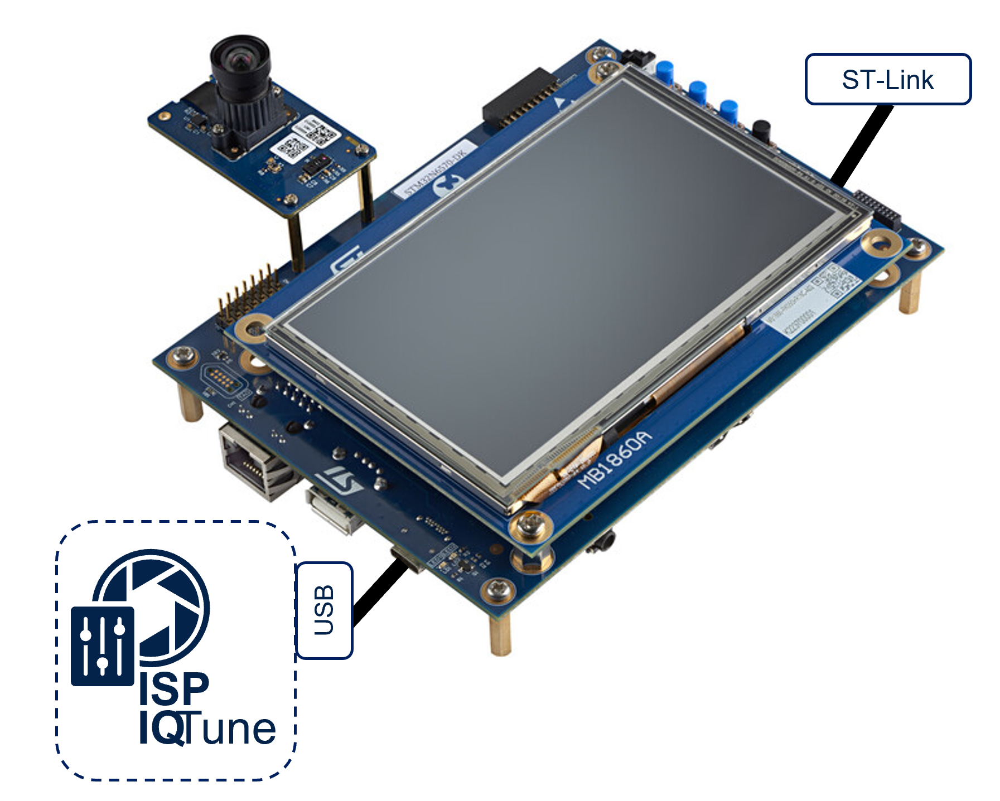

# X-CUBE-ISP


The X-CUBE-ISP package provides the functionality to control and tune the
DCMIPP ISP present in the STM32N6x products.<br>
It contains:<br>
- An embedded ISP Library middleware (running on the target) hosting 2A
  algorithms (Auto Exposure and Auto White Balance) and mechanisms to control
  the ISP and load sensor tuning file.<br>
`x-cube-isp/Middlewares/ST/STM32_ISP_Library`
- A tuning application (running on the target) that allows to interact
  with the STM32 ISP IQTune desktop application executed on the host computer
  and connected through USB.<br>
`x-cube-isp/Projects/DCMIPP_ISP/ISP_IQTune_App`
- A preview application (running on the target) that displays the ISP camera
  stream on the STM32N6570-DK LCD.<br>
`x-cube-isp/Projects/DCMIPP_ISP/ISP_Preview_App`

To take control of the DCMIPP ISP:<br>
- The host computer must execute the STM32 ISP IQTune desktop application and
connect to the target thanks to an USB-C cable on the USB1 (CN18) connector of
the board.
- The ISP IQTune App must be loaded and launched on the target.



[Getting started with X-CUBE-ISP Wiki article](https://wiki.st.com/stm32mcu/wiki/ISP:Getting_started_with_X-CUBE-ISP)

## How to use

This repository has been created using the `git submodule` command. Please check the instructions below for proper use. Please check also **the notes at the end of this section** for further information.

1. To **clone** this repository along with the linked submodules, option `--recursive` has to be specified as shown below.

```bash
git clone --recursive https://github.com/STMicroelectronics/x-cube-isp.git
```

2. To get the **latest updates**, in case this repository is **already** on your local machine, issue the following **two** commands (with this repository as the **current working directory**).

```bash
git pull
git submodule update --init --recursive
```

## Table of Contents

README Content

- [Features demonstrated](#features-demonstrated)
- [Hardware Support](#hardware-support)
- [Tools version](#tools-version)
- [Boot modes](#boot-modes)
- [Quickstart using prebuilt binaries](#quickstart-using-prebuilt-binaries)
- [Quickstart using source code](#quickstart-using-source-code)
  - [STM32CubeIDE](#stm32cubeide)
  - [Change the camera module](#change-the-camera-module)
  - [Create binary for boot from flash](#create-binary-for-boot-from-flash)
  - [Program bin files using command line](#program-bin-files-using-command-line)
- [Documentation](#documentation)

## Features demonstrated

- Control of all ISP parameters via desktop application
- Image analysis function for camera sensor tuning
- Generation of sensor ISP tuning file
- Embedded Auto Exposure algorithm (AE)
- Embedded Auto White Balance algorithm (AWB)
- STM32 ISP IQTune application
- STM32 ISP Preview application

## Hardware Support

- MB1939 STM32N6570-DK board
  - The board should be connected to the onboard ST-LINK debug adapter CN6 with
  a __USB-C to USB-C cable to ensure sufficient power__
  - An additional USB-C cable to connect USB1 (CN18) to the host computer for
  the STM32 ISP IQTune desktop application connection

- 7 camera modules are supported:
  - MB1854B IMX335 (Default camera provided with the MB1939 STM32N6570-DK board)
  - STEVAL-66GYMAI VD66GY camera module
  - VD5943 (MONO)
  - VD1943
  - VD65G4
  - VD56G3 (MONO)
  - Raspberry Pi High Quality Camera (IMX477)

Note:<br>
- The support of customer sensors is possible if customers respect the driver
and integration format of the Camera Middleware.

## Tools version

This package is compatible with the following tool version:
- STM32CubeIDE (**v1.17.0**)
- STM32CubeProgrammer (**v2.18.0**)

## Boot modes

The STM32N6 does not have any internal flash. To retain your firmware after
reboot, you must program it in the external flash. Alternatively, you can load
your firmware directly from SRAM (dev mode).<br>
In dev mode, if you turn off the board, your program will be lost.

__Boot modes:__
- Dev mode: load firmware from debug session in RAM (BOOT1 switch to the right,
BOOT0 switch position doesn't matter)
- Boot from flash: Program firmware in external flash (BOOT0 and BOOT1 switch
to the left)

For more information about boot modes, see [Boot Overview](Doc/Boot-Overview.md).

## Quickstart using prebuilt binaries

The `X-CUBE-ISP/Projects/DCMIPP_ISP/Binary` directory hosts:
- The ISP IQTune prebuilt application, which is the tuning application
  (running on the target) that allows interaction with the STM32 ISP IQTune
  desktop application executed on the host computer and connected through USB.
- The ISP Preview prebuilt application, which runs on the target and displays
  the camera stream processed by ISP on the STM32N6570-DK LCD.

The `X-CUBE-ISP/Projects/DCMIPP_ISP/Binary` directory contains all-in-one HEX files.
Each file already includes both:
- the FSBL image
- the signed application image

These binaries are ready to use with STM32CubeProgrammer in a single flash operation.

Applications are available for MB1939 STM32N6570-DK board.

1. Toggle BOOT1 switch to right position
2. Program one of these binaries as described in [Program bin files using command line](#program-bin-files-using-command-line):
  - `X-CUBE-ISP/Projects/DCMIPP_ISP/Binary/STM32N6_ISP_IQTune_App.hex`
  - `X-CUBE-ISP/Projects/DCMIPP_ISP/Binary/STM32N6_ISP_Preview_App.hex`
3. Toggle BOOT0 and BOOT1 switch to left position
4. Reset board


## Quickstart using source code

Make sure the boot switches are in dev mode (BOOT1 is on the right side).

### STM32CubeIDE

Open one of the following projects in STM32CubeIDE, then build and run:
- `X-CUBE-ISP/Projects/DCMIPP_ISP/ISP_IQTune_App/STM32N6570-DK/STM32CubeIDE/.project`
- `X-CUBE-ISP/Projects/DCMIPP_ISP/ISP_Preview_App/STM32N6570-DK/STM32CubeIDE/.project`

### Change the camera module

The software is natively compatible with the MB1854B IMX335 and STEVAL-66GYMAI
VD66GY camera modules. Simply change the camera module and restart the software.
No software reconfiguration is needed.

Note:<br>
 - For customer camera module, the sensor driver must be added in the Camera
 Middleware and a first tuning must be performed with the STM32 ISP IQTune
 desktop application to generate the final isp_param_conf.h that can be
 updated.

### Create binary for boot from flash

#### Build the Application

- STM32CubeIDE

1. Double-click `<project_path>/STM32N6570-DK/STM32CubeIDE/.project` to open the project in STM32CubeIDE. Build and run the Release configuration.

2. Sign the binary

Make sure the STM32CubeProgrammer bin folder is added to your path.

Using STM32CubeProgrammer before v2.21:

```bash
STM32_SigningTool_CLI -bin Projects/DCMIPP_ISP/ISP_IQTune_App/STM32N6570-DK/STM32CubeIDE/Release/STM32N6_ISP_IQTune_App.bin -nk -t fsbl -hv 2.3 -o STM32N6_ISP_IQTune_App-trusted.bin
STM32_SigningTool_CLI -bin Projects/DCMIPP_ISP/ISP_Preview_App/STM32N6570-DK/STM32CubeIDE/Release/STM32N6_ISP_Preview_App.bin -nk -t fsbl -hv 2.3 -o STM32N6_ISP_Preview_App-trusted.bin
```

Using STM32CubeProgrammer v2.21 or later:

```bash
STM32_SigningTool_CLI -bin Projects/DCMIPP_ISP/ISP_IQTune_App/STM32N6570-DK/STM32CubeIDE/Release/STM32N6_ISP_IQTune_App.bin -nk -t fsbl -hv 2.3 --align -o STM32N6_ISP_IQTune_App-trusted.bin
STM32_SigningTool_CLI -bin Projects/DCMIPP_ISP/ISP_Preview_App/STM32N6570-DK/STM32CubeIDE/Release/STM32N6_ISP_Preview_App.bin -nk -t fsbl -hv 2.3 --align -o STM32N6_ISP_Preview_App-trusted.bin
```

- Makefile

Ensure all required tools are in your PATH, then build the project:

```bash
make -j8 sign
```
This will generate the signed hex file ready to flash at the right address.


### Program bin files using command line

Make sure the STM32CubeProgrammer bin folder is added to your path.
Program the signed binary at address 0x70100000, as well as the FSBL.

```bash
export DKEL="<STM32CubeProgrammer_N6 Install Folder>/bin/ExternalLoader/MX66UW1G45G_STM32N6570-DK.stldr"

# First Stage Boot Loader
STM32_Programmer_CLI -c port=SWD mode=HOTPLUG -el $DKEL -hardRst -w FSBL/fsbl_fw_lrun.hex

# IQTune app
STM32_Programmer_CLI -c port=SWD mode=HOTPLUG ap=1 -el $DKEL -hardRst -w <project_path>/STM32N6_ISP_IQTune_App-trusted.bin 0x70100000
# OR Preview app
STM32_Programmer_CLI -c port=SWD mode=HOTPLUG ap=1 -el $DKEL -hardRst -w <project_path>/STM32N6_ISP_Preview_App-trusted.bin 0x70100000
```
Note: Only one application should be programmed at a time because both applications use the same memory sections.

## Documentation
[MCU ISP wiki article](https://wiki.st.com/stm32mcu/wiki/Category:ISP)
